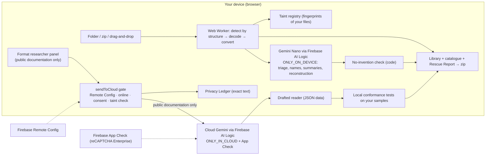

# Reopen

**Drop in a folder from an old computer. Your files come back, readable, and nothing leaves your laptop.**

Reopen rescues everyday files that nothing opens any more: old word-processor documents, legacy spreadsheets,
and text saved in legacy encodings such as Shift_JIS, EUC-JP, Windows-1252 or EBCDIC. It converts them to
DOCX, Markdown, CSV and PNG, gives them sensible names, and builds a browsable catalogue. Everything runs in
your browser. The AI that helps (Gemini Nano) runs **on your device**, through Firebase AI Logic.

- **Hosted demo:** https://reopen-751ea.web.app (desktop Chrome; Gemini Nano optional)
- **Demo video (2:45):** https://youtu.be/WDQdlzX-Ni4
- **Devpost:** https://devpost.com/software/reopen-bzark7
- **Built for:** #BuildHybridAI 2026 (Web / Chrome). Licence: Apache-2.0.

## The routing rule

> **Your files never leave your laptop. Only public documentation you choose goes to the cloud.**

| Step | Runs where | Why there (cost · privacy · fresh knowledge) |
|---|---|---|
| Format detection by file structure, conversion to DOCX/Markdown/CSV/PNG | Your browser, deterministic code (Web Worker) | Free, private, works offline. Known formats need no AI at all. |
| Encoding detection (Shift_JIS, EUC-JP, CP1252, EBCDIC) | Your browser, deterministic code; Gemini Nano double-checks that the result reads as natural text | Private and free. Statistics do the decoding; Nano only says "this looks garbled". |
| Per-file triage: category, two-line summary, proposed file name | **Gemini Nano on-device** (`InferenceMode.ONLY_ON_DEVICE`) | The file's text is personal, so it stays on the device. Free per call, works offline. |
| Paragraph and heading reconstruction of recovered text | **Gemini Nano on-device**, then checked in code by the no-invention rule | Private, and verifiable: every output word must exist in the recovered text. |
| Format researcher: drafting a reader for an unknown format | **Cloud Gemini** (`InferenceMode.ONLY_IN_CLOUD`), explicit opt-in | Reading a specification needs a larger model, and the input is public documentation, not your files. |
| Testing the drafted reader on your sample files | Your browser | Your files are never sent. The reader is declarative data, never executed code. |
| App Check, Remote Config | Firebase | Protects the AI endpoint. Remote Config switches the cloud lane and tunes batch and model settings. |

What makes the rule enforceable rather than a promise:

- Code that touches file contents only uses `ONLY_ON_DEVICE` models. `PREFER_ON_DEVICE` is banned in `src/`, because it would quietly fall back to the cloud.
- Exactly one function can reach a cloud model: `sendToCloud` in `src/ai/cloud-gate.ts`. Before sending, it checks:
  - the Remote Config switch is on
  - the browser is online
  - you consented to that **exact** text (a single-use token tied to its SHA-256)
  - the text contains no bytes or text copied from any file you dropped in
- The exact text is written to the Privacy Ledger *before* it is sent.
- An architecture test fails the build if any other module creates a cloud model.
- Every AI result carries an **ON DEVICE** or **CLOUD** badge taken from the SDK's own `response.inferenceSource`, never guessed.

## Architecture



## What it can read

Checked against each library's own documentation, and tested on the self-made samples in `samples/` (see `SAMPLES.md`).

| Level | Formats |
|---|---|
| **Full conversion** | Text in Shift_JIS, EUC-JP, Windows-1252 and EBCDIC (code pages 37, 20273, 500, 1026, 1047, 1140, 20290). Spreadsheets: Excel 2.x–2003 `.xls` (BIFF2/5/8), SYLK, DIF, Excel 2003 XML, dBASE. These are values only; formatting is not kept. BMP images → PNG. |
| **Text and paragraphs** | RTF (headings, lists, pictures), Word 97–2003 `.doc` (text from Microsoft's public [MS-DOC] spec; no formatting), Microsoft Write `.wri`. |
| **Text recovery** (shown raw and clearly labelled, optionally reconstructed on-device) | WordPerfect (one self-made sample), and any file whose format is unknown. |
| **Detected, not tested on real files** | Word 6/95 `.doc` (falls back to text recovery), Lotus 1-2-3, Quattro Pro, Works and Ichitaro. Detection code exists, but there are no samples, so whether they convert well is unknown. |
| **Format researcher** | Formats with public documentation. The demo uses a self-made, fictional format (`docs/specs/quillstone-notebook-qnb.md`). |

Detection uses file structure (magic numbers, OLE stream names, record layouts), never the file extension.

## Enable Gemini Nano in Chrome

Reopen works without Nano: conversion is deterministic, and recovered text is shown raw and labelled. Nano adds the on-device triage, names, summaries and reconstruction.

1. Use **Chrome on desktop**, version 139 or later (the minimum for Firebase AI Logic hybrid inference).
2. Check that your computer meets Chrome's hardware and OS requirements for built-in AI: https://developer.chrome.com/docs/ai/get-started. Among other things, Chrome needs at least 22 GB free on the drive that holds your profile, and an unmetered connection for the one-time download.
3. Open Reopen and click **Wake on-device AI**. Chrome downloads Gemini Nano once and shows progress.
4. To check by hand:
   - open `chrome://on-device-internals`, or
   - run `await LanguageModel.availability()` in the DevTools console. It should return `"available"`.
5. Flags: none were needed in Chrome 156 for text. The Firebase docs list `chrome://flags/#prompt-api-for-gemini-nano-multimodal-input`; enable it only if `LanguageModel` is missing in your Chrome.

## Run it yourself

Requirements: Node.js 20.12 or later, npm, and a Firebase project.

```bash
npm ci
cp .env.example .env.local            # fill in your Firebase web config (never commit it)
npm run dev                            # http://localhost:5173
npm test                               # unit + property tests (vitest + fast-check)
npm run test:e2e                       # Playwright, uses your installed Chrome
npm run smoke                          # diagnostic page: one on-device and one cloud call
```

Firebase setup:

1. Create a Firebase project.
2. Add a web app and copy its config into `.env.local`.
3. AI Logic → **Gemini Developer API**.
4. App Check:
   - Register **reCAPTCHA Enterprise** with a Web key for your hosting domains.
   - For local development, leave `VITE_APPCHECK_DEBUG_TOKEN` empty, copy the debug token the SDK prints in the console, and register it under App Check → Manage debug tokens. Never commit it.
5. Deploy: `npm run build && firebase deploy --only hosting,remoteconfig`
   - The Remote Config template is `firebase/remoteconfig.template.json`.
   - Parameters: `cloud_lane_enabled`, `batch_size`, `cloud_model`, `cloud_max_output_tokens`, `cloud_thinking_level`, `nano_chunk_chars`, `ai_max_attempts`.
   - The app's built-in default keeps the cloud lane **off**.

## Tests

- **Property-based** (fast-check):
  - the no-invention rule, in the core checker and at the AI boundary
  - no cloud payload ever contains file bytes (raw, hex or base64) or copied file text
  - encoding detection round-trips
  - detection and the reader interpreter never throw on random bytes
- **Fallback paths:** Nano unavailable or still downloading, no Prompt API, Firebase not configured, offline, cloud lane disabled by Remote Config, consent declined or reused.
- **Architecture:**
  - only the two model factories create models
  - only the composition root hands the cloud factory to the gate
  - no `PREFER_*` modes anywhere
- **End to end:** Playwright in Chrome against the local build or the hosted demo (`tests/e2e/README.md`).

## Honesty notes

- All sample files are self-made and fictional. The Word 97, Write and WordPerfect samples were written from public format descriptions, not saved by the original programs.
- Word 97 conversion keeps text and paragraphs, not formatting. WordPerfect and similar formats only get text recovery, because their only readers are LGPL/MPL licensed, and Reopen uses MIT, Apache-2.0 and BSD-family code only (see `NOTICE`).
- See `docs/core-status.md`, `docs/ui-status.md` and `docs/research-status.md` for what is verified and what is not.

## Acknowledgements

- The first UI pass followed the design checklist in [heydamir/unslop](https://github.com/heydamir/unslop) (CC-BY-4.0). Only its principles were applied; no files, text or code were copied.
- The v1.1 design pass followed [leonxlnx/taste-skill](https://github.com/leonxlnx/taste-skill) (MIT). The grain texture, the stage gradient and the button timing were adapted from it; see `NOTICE`.

## Licence

Apache-2.0 (`LICENSE`). Third-party notices are in `NOTICE`.
